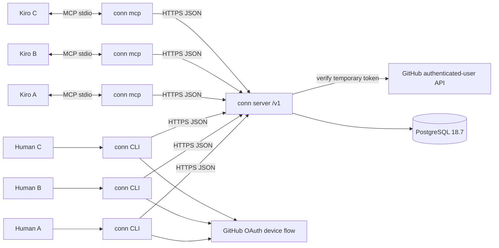

# Design

## Purpose

This specification implements the first product-bearing Conn slice: three GitHub-authenticated humans join one Project, share one narrative Objective, review one immutable BlueprintRevision containing three CellCharter snapshots, accept their own charters through the CLI, and read the resulting state from three independent Kiro sessions through read-only MCP tools.

This slice validates shared accountability and protocol behavior. It does not implement change intents, collision detection, evidence compilation, a web application, other coding-agent integrations, offline operation, or customer migration execution.

## System context



MCP is a Kiro adapter, not the team synchronization transport. Work cells communicate through authoritative backend records and project events.

## Runtime modes

One Go binary exposes distinct modes:

- `conn server`: run the backend HTTP service;
- `conn mcp`: run the Kiro MCP adapter over stdio;
- other Cobra commands: perform authenticated human operations through the backend API.

Cobra, `net/http`, MCP SDK, PostgreSQL, credential-store, and GitHub client types remain inside adapters. Application operations do not depend on those types.

## Package boundaries

Planned Go boundaries:

```text
cmd/conn                 process entry point and build metadata
internal/cli             Cobra commands and output rendering
internal/application     authorization-aware use cases and transaction boundaries
internal/auth/github     GitHub device flow and identity verification adapters
internal/credentials     OS keyring and environment-token resolution
internal/httpapi         /v1 handlers, middleware, limits, and error mapping
internal/httpclient      CLI and MCP backend client
internal/mcp             official MCP SDK adapter and read-only tools
internal/postgres        pgx repositories, transactions, projections, and events
internal/migrations      embedded Conn database migrations and version checks
internal/protocol        handwritten protocol types verified against the schemas
internal/contracts       JSON Schema compilation and validation
```

Protocol types live only in `internal/protocol` (decision 0033). They are handwritten Go types held to the canonical schemas by a conformance test over the shared fixtures. No other package may create its own copy of a canonical protocol record.

## Canonical contracts

Initial JSON Schema Draft 2020-12 files:

```text
contracts/v1/project.schema.json
contracts/v1/project-membership.schema.json
contracts/v1/objective.schema.json
contracts/v1/blueprint-revision.schema.json
contracts/v1/charter-decision.schema.json
contracts/v1/event-envelope.schema.json
```

Use stable identifiers such as:

```text
urn:conn:schema:v1:objective
urn:conn:schema:v1:blueprint-revision
```

All authoritative objects reject unknown properties unless a reviewed extension point requires them. UUIDv7 values serialize as lowercase canonical UUID strings. Timestamps use RFC 3339 UTC strings.

Schema validation covers document structure. Application validation covers unique point keys, valid Objective references, valid cell dependencies, project membership, authority, lifecycle, and optimistic concurrency.

### Project

Required protocol content:

- `project_id` UUIDv7;
- human-readable `name`;
- `owner_human_id` UUIDv7;
- `created_at`.

Project membership is stored separately with `owner` or `member` role.

### Objective revision

Required content:

- `objective_id` UUIDv7;
- `project_id` UUIDv7;
- positive integer `revision`;
- `title`;
- `overview_markdown`;
- `accountable_human_id` UUIDv7;
- `created_at`.

Optional content:

- human-readable `key`;
- `source_refs`;
- a small `key_points` array.

Each key point has a slug-like key, a kind from the accepted Objective vocabulary, and a concise statement. There is no minimum key-point count.

### Blueprint revision

Required content:

- `blueprint_id` UUIDv7;
- `project_id` UUIDv7;
- positive integer `revision`;
- exact `objective_id` and `objective_revision`;
- `proposed_by_human_id`;
- `created_at`;
- complete `cell_charters` array.

Each CellCharter requires:

- stable `cell_id` UUIDv7;
- `accountable_human_id` UUIDv7;
- `title`;
- `overview_markdown`.

Optional charter content:

- Objective point-key references;
- keyed boundary points;
- dependencies containing a target cell ID and summary.

### Charter decision

An append-only decision records:

- project, blueprint, revision, cell, and human identity;
- `accept` or `reject` outcome;
- timestamp;
- rationale, required for rejection and optional for acceptance.

A unique acceptance for the same human, cell, and BlueprintRevision is idempotent. Rejection is retained and cannot be overwritten. Resolving rejection requires a new BlueprintRevision.

### Event envelope

Every committed authoritative mutation appends:

- `project_id`;
- positive `event_sequence`;
- `event_id` UUIDv7;
- event type;
- entity type and ID;
- actor human ID;
- occurred-at timestamp;
- payload containing only non-secret event data.

Event sequence is assigned transactionally within one Project. Responses that depend on project state include the `as_of_event` cursor.

## Model-generation gate

Decision 0009 intentionally deferred model generation. The implementation sequence therefore begins with schemas and shared fixtures. Before persistent domain records or public handlers are implemented:

1. Validate accepted and rejected fixtures through Ajv and the Go JSON Schema validator.
2. Review schema names, references, optionality, and error quality.
3. Compare generation options against the accepted schemas.
4. Ask the project owner to approve a generation strategy.
5. Record that decision before creating protocol models.

Decision 0033 resolved this gate: protocol types are handwritten Go types in `internal/protocol`, held to the schemas by one conformance test over the shared fixtures. TypeScript models remain deferred.

Untyped maps or generic JSON values must not spread beyond schema-validation and persistence-envelope boundaries.

## Authentication flow

### CLI and GitHub

1. `conn login` reads the GitHub OAuth client ID from approved public configuration.
2. The CLI requests a device code directly from GitHub.
3. It displays the verification URI and user code without logging secret responses.
4. It polls GitHub using the provided interval and handles pending, slow-down, denied, and expired states.
5. The temporary GitHub access token remains in process memory.
6. The CLI sends it once in an authorization header to the dedicated Conn exchange endpoint over HTTPS.
7. The backend calls GitHub's authenticated-user endpoint and reads the immutable GitHub user ID and display login.
8. The backend creates or finds the Conn Human and issues a 256-bit opaque Conn session token.
9. The backend stores only the SHA-256 token hash.
10. The CLI stores the raw Conn token in the OS keyring and discards the GitHub token.

The client requests only identity access. Future repository installation uses separate GitHub App authorization.

### Credential resolution

Local authenticated operations resolve credentials in this order:

1. explicit `CONN_TOKEN` environment variable;
2. native OS credential store;
3. unauthenticated error directing the human to `conn login`.

Environment tokens are never persisted automatically. No plaintext fallback exists.

### Transport security

Production backend URLs must use HTTPS. Plain HTTP is allowed only for explicit loopback development endpoints. HTTP clients use bounded connect, request, and response-body limits. Authorization headers and device tokens are redacted from diagnostics.

## CLI surface

Initial human commands:

```text
conn login
conn logout
conn whoami

conn project create --file <project.json>
conn project member add --project <uuid> --human <uuid>

conn objective create --project <uuid> --file <objective.json>
conn objective revise --project <uuid> --objective <uuid> --expected-revision <n> --file <objective.json>
conn objective show --project <uuid> --objective <uuid> --revision <n>

conn blueprint propose --project <uuid> --file <blueprint.json>
conn blueprint revise --project <uuid> --blueprint <uuid> --expected-revision <n> --file <blueprint.json>
conn blueprint show --project <uuid> --blueprint <uuid> --revision <n>

conn charter accept --project <uuid> --blueprint <uuid> --revision <n> --cell <uuid>
conn charter reject --project <uuid> --blueprint <uuid> --revision <n> --cell <uuid> --reason <text>

conn status --project <uuid>
conn sync --project <uuid> --after <event-sequence>
conn doctor
conn mcp
conn server
```

Secrets are never accepted as command-line flags. File inputs are bounded, parsed once, validated locally, and sent to the backend. The backend repeats validation and application policy checks.

`--file -` reads the document from standard input. Structured commands accept `--json` and print the API envelope on standard output. Exit codes are stable: 0 success, 1 failure, 2 usage or invalid input, 3 authentication, 4 not found or not permitted, 5 conflict, 6 server unavailable, 130 interrupted. Human output replaces control characters in untrusted text and labels every non-active blueprint revision as unapproved.

Cobra commands only parse input, select output mode, invoke an application or HTTP-client operation, and render the result.

## HTTP API

Implemented first-slice endpoints:

```text
GET    /v1/auth/github/client
POST   /v1/auth/github/exchange
DELETE /v1/session
GET    /v1/humans/me

POST   /v1/projects
GET    /v1/projects/{project_id}
POST   /v1/projects/{project_id}/members

POST   /v1/projects/{project_id}/objectives
POST   /v1/projects/{project_id}/objectives/{objective_id}/revisions?expected_revision=<n>
GET    /v1/projects/{project_id}/objectives/{objective_id}/revisions/{revision}

POST   /v1/projects/{project_id}/blueprints
POST   /v1/projects/{project_id}/blueprints/{blueprint_id}/revisions?expected_revision=<n>
GET    /v1/projects/{project_id}/blueprints/{blueprint_id}/revisions/{revision}
POST   /v1/projects/{project_id}/blueprints/{blueprint_id}/revisions/{revision}/cells/{cell_id}/accept
POST   /v1/projects/{project_id}/blueprints/{blueprint_id}/revisions/{revision}/cells/{cell_id}/reject

GET    /v1/projects/{project_id}/status
GET    /v1/projects/{project_id}/events?after=<sequence>&limit=<bounded>

GET    /healthz
GET    /readyz
```

Protected routes authenticate the Conn bearer token. The application then authorizes project membership and role inside the same transaction as the operation, so authorization cannot drift from the state it guards. A non-member response does not distinguish missing from forbidden project resources, and a malformed path ID answers the same `404 not_found`.

Mutation requests carry an expected revision where they modify versioned state. Stale revisions return `409 Conflict`. Client-generated UUIDv7 entity IDs make safe retries possible; idempotency behavior must compare the existing entity and reject conflicting reuse.

Request bodies:

| Route                                      | Body schema                |
| ------------------------------------------ | -------------------------- |
| `POST /v1/projects`                        | `project-create`           |
| `POST .../members`                         | `project-member-add`       |
| `POST .../objectives` and its `/revisions` | `objective-revision-input` |
| `POST .../blueprints` and its `/revisions` | `blueprint-proposal`       |
| `POST .../cells/{cell_id}/reject`          | `charter-rejection`        |
| `POST .../cells/{cell_id}/accept`          | none                       |

Successful `POST` routes return `201`, including idempotent repeats, which return the stored record.

Objective and Blueprint creation and revision use separate routes:

- `POST .../objectives` and `POST .../blueprints` create revision 1. Repeating the same input returns the stored revision; reusing the ID for different content returns `409 id_conflict`.
- `POST .../objectives/{objective_id}/revisions` and `POST .../blueprints/{blueprint_id}/revisions` append the next revision from the same input document. The required `expected_revision` query parameter is the latest revision the author saw and must be at least 1. The body's ID must equal the path value. A stale expectation returns `409 stale_revision`. The expected revision stays outside the document, as the input schemas specify.

`GET .../status` returns `project-status`: the Project, the reader's role, each Objective's current revision, and each Blueprint's revisions in force (the active revision and the latest one when it differs) with per-cell decisions. `GET .../events` returns an array of `event-envelope` documents; `after` defaults to 0 and `limit` to 100, at most 500.

### Error mapping

| Application outcome                                        | HTTP status | Code              |
| ---------------------------------------------------------- | ----------- | ----------------- |
| Missing session                                            | 401         | `unauthenticated` |
| Missing resource, or the actor is not a project member     | 404         | `not_found`       |
| Member attempts an owner-only or another human's operation | 403         | `forbidden`       |
| Client-generated ID reused for different content           | 409         | `id_conflict`     |
| Expected revision is not current                           | 409         | `stale_revision`  |
| Charter already has a different decision                   | 409         | `charter_decided` |
| Schema or application validation failure                   | 422         | `invalid_input`   |

Transport failures before the application runs:

| Request problem                     | HTTP status | Code                     |
| ----------------------------------- | ----------- | ------------------------ |
| Body is not `application/json`      | 415         | `unsupported_media_type` |
| Body exceeds 1 MiB                  | 413         | `request_too_large`      |
| Body is not one valid JSON document | 400         | `invalid_json`           |

`invalid_input` errors carry an optional `pointer` with the JSON Pointer of the offending input field, omitted when the problem is a request parameter or the document root.

### Response shape

Successful structured responses use one envelope:

```json
{
  "data": {},
  "as_of_event": 42
}
```

Errors use a stable code and safe message without internal details or secrets:

```json
{
  "error": {
    "code": "stale_revision",
    "message": "The blueprint revision is no longer current."
  }
}
```

Exact error codes are listed in the error mapping tables above.

## MCP tools

Use the official Go MCP SDK over stdio. Initial tools are read-only:

- `read_objective`;
- `read_blueprint`;
- `read_my_charter`;
- `check_updates`.

`read_my_charter` derives the human from the stored Conn session and does not accept a human ID as an authority selector. Inputs may select Project, Objective, Blueprint, revision, cell, or event cursor only where the authenticated human is authorized.

MCP handlers call the same backend HTTP client used by CLI read commands. They do not access PostgreSQL directly.

The project comes from `project_id` tool input, else the `CONN_PROJECT` variable in the Kiro MCP configuration. Tool results use the API envelope, with a one-line summary that says plainly when a revision is unapproved. `read_my_charter` returns the `charter-view` read model, composed from `GET /v1/humans/me`, project status, and the revision snapshot, so no new backend route is needed. Tool input schemas reject unknown properties, so `human_id` cannot be passed.

## Application lifecycle

### Objective

- Creation produces revision 1 through the create route.
- Later changes append revisions through the revisions route and require the previous expected revision.
- Revisions are immutable.

### Blueprint

- Only the project owner proposes (decision 0027). Proposal produces an immutable `proposed` revision. Status is served beside the snapshot, never inside it.
- It references an exact Objective revision and includes all charter snapshots.
- Each accountable human may accept or reject only their own charter.
- The final required acceptance changes the BlueprintRevision projection to `active` in the same transaction as acceptance and event append.
- Rejection changes the projection to `rejected` and retains the decision.
- Charter changes produce another BlueprintRevision.
- A blueprint has at most one `active` revision and one `proposed` revision. The active revision stays in force while a replacement is reviewed, so work is never left without a ratified partition.
- Proposing a new revision marks a pending proposal `superseded`. Activating a revision marks the previous active one `superseded`. Both happen in the same transaction as the triggering change.
- Status moves only from `proposed` to `active`, `rejected`, or `superseded`, and from `active` to `superseded`.

## PostgreSQL design

Initial logical tables:

- `humans`;
- `sessions`;
- `projects`;
- `project_memberships`;
- `objectives` current projection;
- `objective_revisions` immutable records and source JSON;
- `blueprints` current projection;
- `blueprint_revisions` immutable source JSON;
- `blueprint_cells` query projection;
- `charter_decisions` append-only records;
- `project_event_counters`;
- `events` append-only records.

Canonical UUID values use PostgreSQL `uuid`. Revisions use positive integers. Event sequences use `bigint` and a project-scoped uniqueness constraint.

A project event sequence is reserved by locking and advancing its counter row within the same transaction that changes state. Rollback reverts both the state and counter update, so committed event sequences remain gap-free within the project.

Authoritative JSON snapshots use `jsonb` while important identity, revision, status, ownership, and authorization fields are projected into typed columns with constraints and foreign keys.

## Internal migrations

Goose SQL migrations are Conn backend infrastructure. They are not public CLI commands or MCP tools.

- Local development invokes them through a repository script such as `pnpm db:migrate`.
- CI applies them before persistence scenarios.
- Deployment automation applies them after backup and before new server instances become ready.
- `conn server` checks schema compatibility but does not mutate schema.
- Customer project migrations are never executed by Conn.

The implementation may use an internal development/deployment entry point that is not included in end-user command help.

## Development database

Docker Compose runs PostgreSQL 18.7 only. It binds to loopback, uses a named volume, and has a health check. Conn runs directly on the host. Ordinary start, stop, check, and migration scripts never delete the volume.

Development credentials are non-production values and may be documented because the port is loopback-only. Production credentials remain external secrets.

## Fundamental validation plan

Keep the suite small:

1. One shared contract fixture table, consumed by Go and Node.js, accepts representative Project, Objective, BlueprintRevision, CharterDecision, and EventEnvelope documents and rejects one focused invalid case per fundamental rule.
2. One PostgreSQL transaction scenario proves state and event append commit or roll back together.
3. One authorization and ratification scenario covers three humans, forbidden cross-human acceptance, two-of-three proposed state, final activation, and rejection immutability.
4. One authentication table covers device pending, slowdown, denial, expiry, exchange, session expiry/revocation, and redaction through fakes.
5. One CLI behavior test covers JSON output, stderr separation, and stable exit classification.
6. One MCP subprocess scenario initializes over stdio, reads the authenticated human's charter, checks an event cursor, and exits cleanly.

Do not create a test for every handler, repository method, schema property, or Cobra command when these scenarios already protect the public guarantee.

## Observability and data minimization

- Generate a request ID for diagnostics but never use it as authority.
- Log operation name, safe actor and Project IDs, result category, duration, and request ID.
- Do not log request bodies containing Markdown or tokens by default.
- Do not store raw GitHub tokens.
- Do not collect source code, prompts, or Kiro transcripts in this slice.
- Events contain structured coordination facts, not secrets or raw external payloads.

## Deferred work

- Web application
- Kiro write tools and agent-authored proposals
- Other coding-agent integrations
- BoundaryContract artifacts
- Change intents and semantic collision detection
- Evidence obligations beyond charter text
- TypeScript repository analyzer implementation
- Local SQLite outbox
- Background synchronization, SSE, and WebSockets
- GitHub repository installation and checks
- Organization and team hierarchy
- Invitation codes and member search
- Production deployment platform
