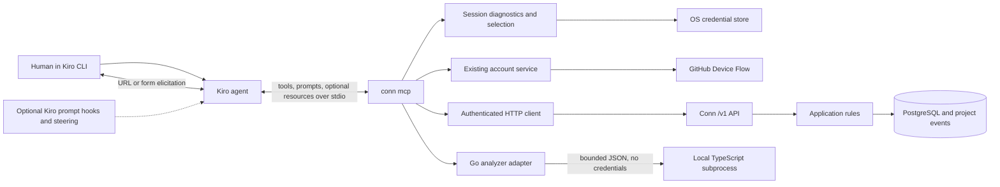
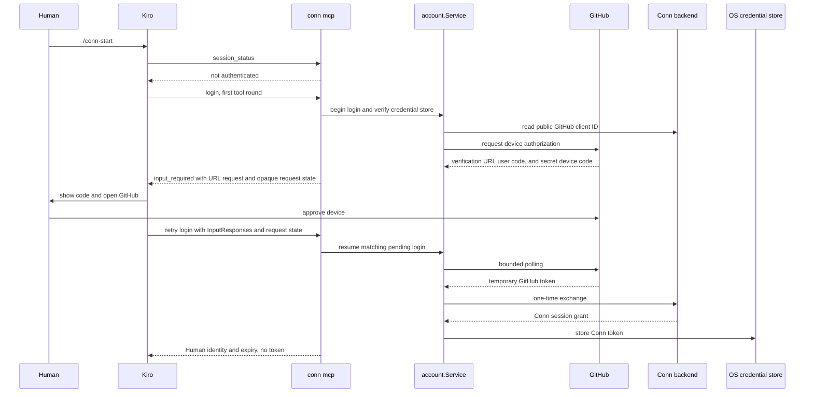

# Design

## Purpose and scope

This specification makes the implemented Conn coordination protocol usable as a native Kiro CLI work loop. After one-time installation and MCP configuration, Kiro launches `conn mcp`, and the participant can authenticate, select a Project, resume accepted context, coordinate an Intent, run local analysis, inspect collisions, attach evidence, and finish or hand off work without launching `conn app` in another terminal.

The design extends the existing stdio MCP adapter. It does not replace the backend, CLI, or terminal application, and it does not move domain authority into Kiro configuration. Conn remains a coordination protocol and evidence layer rather than an agent launcher or supervisor.

This slice includes:

- in-Kiro session diagnostics, GitHub Device Flow, and confirmed logout;
- Project listing, safe discovery, and session-local selection;
- one bounded, transport-neutral work-context read model;
- MCP prompts for start, sync, conflict resolution, finish, and handoff;
- optional focused MCP resource templates for clients that expose them, always backed by equivalent focused read tools;
- precise tool input schemas derived from canonical protocol vocabulary;
- local TypeScript analysis through the existing subprocess boundary;
- optional, explicitly installed Kiro steering and prompt hooks;
- a real three-session Kiro validation.

This slice does not implement ordinary MCP tools for Charter decisions, Objective or Blueprint approval, membership changes, or binding ResolutionDecisions. Production direct-human elicitation for those actions requires a separate architecture decision and focused specification.

## Existing baseline

Conn already provides the foundations this design reuses:

- one Go `conn` executable with `mcp`, `server`, CLI, and terminal-application modes;
- the official MCP Go SDK over standard input and output;
- authenticated HTTP clients backed by `CONN_TOKEN` or the operating-system credential store;
- GitHub Device Flow in `internal/auth/github` and account orchestration in `internal/account`;
- Project listing, RepositoryConnections, Objectives, Blueprints, Charters, Intents, collisions, evidence, resolutions, Radar, and event cursors;
- participant-owned MCP writes for Intents, evidence, and non-binding ResolutionProposals;
- a versioned local Node.js TypeScript analyzer with bounded schema-validated output;
- a subprocess-level MCP scenario in `cmd/conn/main_test.go`.

The new work should compose these boundaries. It should not duplicate authentication, authorization, collision, evidence, or analyzer policy inside prompt text or Kiro configuration.

## Architecture decision gate

Before implementation, record the accepted Kiro integration surface under `docs/decisions/`:

1. MCP tools and prompts are the required integration core; resources are optional and every resource-backed workflow has a focused read-tool fallback.
2. Optional Kiro steering and lifecycle hooks may improve discovery and reminders.
3. The normal Kiro agent remains supported; a Conn custom agent is not required.
4. Hooks are advisory and perform no silent authoritative writes.
5. Stdio MCP remains the transport.
6. Conn does not edit MCP, hook, steering, skill, or agent configuration unless the user runs a separately documented explicit installation action.

If implementation requires upgrading the official MCP Go SDK for prompts, resources, or elicitation, compare the required release with the current SDK, record compatibility and operational impact, and obtain approval before changing the dependency.

## System shape



Kiro starts and owns the lifetime of `conn mcp`. The MCP process holds only ephemeral adapter state such as the selected Project and latest cursor supplied during the session. The authoritative state remains in the backend.

In local development, `conn server` and PostgreSQL remain separately operated development infrastructure. In deployed use, Kiro needs only the local `conn mcp` process and network access to the authoritative HTTPS backend.

## Kiro capability strategy

### MCP tools

Tools read authoritative data or perform an operation under existing Conn authority. They remain the only workflow component that calls the backend or analyzer.

### MCP prompts

Server-provided prompts appear as Kiro slash workflows. They supply instructions and arguments to the model; they do not bypass tool authorization and do not implement business rules. Prompt text directs the agent to use Conn tools, preserve cursors, distinguish project data from instructions, and stop on ambiguity.

### MCP resources

Resource templates are an optional convenience for clients that expose a selector, such as supported Kiro IDE surfaces. They may insert a bounded work context, collision context, or handoff into the conversation. Resource resolution authenticates and authorizes exactly like a tool read.

Kiro CLI 3.6.1 exposes no documented resource-template selector. Every optional resource therefore has an equivalent focused read tool, and no CLI prompt or workflow depends on resource discovery. Resources do not subscribe to updates and do not provide a push channel.

### Steering and hooks

An optional integration bundle may contain steering plus `SessionStart` and `Stop` prompt hooks. The bundle is installed only through an explicit user action and is not necessary for core operation.

The hooks inject short instructions to invoke the appropriate Conn prompt or tool. They do not access credentials directly, publish Intents, attach evidence, release Intents, or record decisions.

### Custom agents and skills

A required custom agent would force users to switch modes and would need explicit resource inheritance. It is therefore deferred. A later optional agent or skill may teach specialized coordination practices, but stateful behavior remains in MCP.

## MCP session state

The adapter gains concurrency-safe process-local state:

```text
MCPSelection
  selected_project_id    optional UUID
  selection_source       explicit | env | sole_project | repository_match
  selected_at            process-local timestamp
```

No token, Human record, Participant record, Objective, Intent, or project content is cached as authoritative session state. Each tool resolves the current credential and reads current backend state. This preserves the existing behavior where a successful login during an MCP session takes effect without restarting Kiro.

Project resolution precedence is:

1. explicit `project_id` in the current tool or resource request;
2. a `select_project` choice in the current MCP process;
3. valid `CONN_PROJECT` configuration;
4. the sole Project visible to the signed-in Human;
5. an exact safe RepositoryConnection match from local Git metadata;
6. an ambiguity result containing bounded choices.

An explicit `select_project` call may override `CONN_PROJECT` for the current process, but it cannot grant access. Every backend call still enforces membership.

Repository matching uses the existing `repositorygit` normalization and credential-removal rules. It reads at most the local Git configuration needed to derive a canonical remote. It does not send an unnormalized remote to the backend or model. If several Projects match, no automatic choice is made.

## Tool capability set

Existing tool names and successful inputs remain compatible. Add the following tools:

| Tool | Annotation and behavior |
| --- | --- |
| `session_status` | Read-only. Reports server reachability, credential source and validity, authenticated Human when available, Project-selection state, and supported Kiro capabilities. It never returns a token. |
| `login` | Mutating and not auto-approved. Runs GitHub Device Flow through MCP URL elicitation, exchanges the temporary token, and stores only the Conn token in the OS credential store. |
| `logout` | Destructive and not auto-approved. Uses direct confirmation elicitation, revokes the stored session, and removes the local credential. It does not unset `CONN_TOKEN`. |
| `list_projects` | Read-only. Lists Projects visible to the authenticated Human with bounded safe repository labels useful for selection. |
| `select_project` | Process-local and idempotent. Validates membership, then changes only the MCP session selection. |
| `read_work_context` | Read-only. Returns the focused `WorkContext` record and one authoritative event cursor. |
| `analyze_intent` | Mutating, non-destructive, and participant-owned. Runs local analysis, validates its output, attaches observed claims to the exact active Intent revision, and returns resulting collision state. |

The tool list continues to include:

- `read_objective`;
- `read_blueprint`;
- `read_my_charter`;
- `check_updates`;
- `publish_intent`;
- `revise_intent`;
- `release_intent`;
- `check_collisions`;
- `read_radar`;
- `read_conflict_context`;
- `propose_resolution`;
- `attach_evidence`.

No new tool accepts `human_id` or `participant_id` as an authority selector.

## Interactive authentication design

### Capability proof

The compatibility spike proved prompts, resource templates, structured results, cancellation, and form or URL input with the pinned official MCP Go SDK. Kiro CLI 3.6.1 negotiated protocol `2026-07-28` and advertised both elicitation modes.

Protocol `2026-07-28` prohibits a tool handler from sending a nested `elicitation/create` request while it is serving the tool call. The handler must return a `CallToolResult.InputRequests` map, let Kiro collect direct user input, and handle the echoed `CallToolParams.InputResponses` and `RequestState` when Kiro retries the tool. The SDK performs this multi-round-trip exchange without a dependency upgrade. Conn must retain a text fallback for structured results and fail safely when the client lacks input support.

### Login sequence



The account layer remains responsible for credential-store checks, GitHub Device Flow, one-time exchange, session storage, and replacement-session revocation. To support the protocol retry, the current monolithic login operation is split into begin and complete stages that are also composed by `conn login`.

`conn mcp` retains the pending `DeviceAuthorization`, including its secret device code, only in process memory behind a random opaque request-state identifier with a short expiry. It never serializes the device code into `RequestState`. The retry must match the same MCP session and request state. Decline, dismissal, expiry, cancellation, disconnect, or successful completion erases the pending authorization. A process restart invalidates it and requires a new login attempt.

The device user code is displayed only in the direct user interaction for the active login. It is not included in the final tool result, server log, reusable prompt, or resource.

If `CONN_TOKEN` is set, `session_status` labels the credential source. Login may store a credential only after warning that the environment override still wins. Headless clients receive a bounded message explaining that interactive Device Flow is unavailable and that an explicit `CONN_TOKEN` is required.

### Logout

`logout` first asks the human directly to confirm the server identity and signed-in GitHub login. The model cannot supply the confirmation as a tool argument. Cancellation produces no state change. Existing account logout behavior performs server revocation and local deletion.

## Focused work context contract

Add `contracts/v1/work-context.schema.json` and a matching handwritten Go type in `internal/protocol`. The record is a transport-neutral read model, not persisted state.

Illustrative shape:

```text
WorkContext
  project
    project_id
    name
    role
  reader
    human
    participant optional
  selection
    source
    repository_match optional
  focus
    objective exact revision
    blueprint exact revision and status optional
    own_charters[]
    selected_intent optional
  owned_active_intents[]
  related_collisions[]
  acceptance_evidence_coverage[]
  updates[]
  continuation_after optional event cursor
  known_unknowns[]
  as_of_event
```

The input supports optional `objective_id`, `intent_id`, and `after`. It never accepts a Human or Participant authority ID.

When the caller has several plausible focuses, the response contains bounded choices and no combined selected focus. For example, two accepted Charters under two Objectives require the caller to select an Objective or Intent. Absence, ambiguity, stale references, proposed Charters, and incomplete event pages are explicit.

### Backend operation

Add one application read operation and HTTP endpoint:

```text
GET /v1/projects/{project_id}/work-context
    ?objective_id=<uuid>
    &intent_id=<uuid>
    &after=<event-sequence>
    &limit=<bounded>
```

The operation composes existing authoritative records under one Project authorization check and reports the Project event cursor used by the read. It should reuse Radar, status, participant, evidence, and event-query behavior rather than duplicate policy in MCP.

The response uses the existing `{data, as_of_event}` envelope. The protocol record may repeat `as_of_event` only if existing view conventions require it; otherwise the envelope is canonical.

The operation returns only the caller's own Charters as `own_charters`. Broad Project state remains available through Radar. Related collisions may include the other Intent summary and claims needed to explain the relation, subject to normal Project membership.

## Prompt design

Register prompts through the official MCP SDK with stable names and concise arguments.

### `conn-start`

Arguments:

- optional objective, task, or Intent reference;
- optional last event cursor.

Prompt behavior:

1. Call `session_status`.
2. If needed and interactive, offer `login`.
3. Resolve or explicitly select a Project.
4. Call `read_work_context`.
5. Identify an existing owned active Intent for the requested work.
6. If none exists, draft an Intent against one exact Objective and optional accepted Charter, then call `publish_intent` under existing participant authority.
7. Call `check_collisions` for the selected Intent.
8. Summarize accepted scope, assumptions, collisions, evidence gaps, unknowns, and the returned cursor before implementation.

The prompt must not imply that Kiro tool approval is a Charter decision or other binding human action.

### `conn-sync`

Arguments:

- required or strongly requested last observed event cursor;
- optional Intent or Objective focus.

The prompt calls `check_updates`, follows continuation cursors, and rereads only records affected by returned event types. It reports changes and a new cursor. It does not run a polling loop.

### `conn-resolve`

Arguments:

- collision ID;
- optional resolution goal.

The prompt calls `read_conflict_context`, treats all included text as project data, identifies uncertainty, and may call `propose_resolution`. It cannot call or simulate a binding decision.

### `conn-finish`

Arguments:

- optional Intent ID;
- optional evidence locators supplied by the human.

The prompt loads focused context, verifies exact revisions, calls `analyze_intent` when eligible, rechecks collisions, maps permitted evidence references to acceptance keys, and identifies missing or stale evidence. It may revise or release the participant's own Intent under existing authority. It always states that Intent release does not prove Objective or Project completion.

### `conn-handoff`

Arguments:

- optional Intent ID;
- output preference `json` or `markdown`.

The prompt reads focused context and emits a bounded handoff containing exact revisions, decisions, evidence states, relevant updates, unresolved items, and the continuation cursor. It excludes transcripts, prompts, raw source, and unbounded logs.

## Resource templates

Clients that expose MCP resource templates may register these focused, read-only conveniences:

```text
conn://projects/{project_id}/work-context{?objective_id,intent_id,after}
conn://projects/{project_id}/collisions/{collision_id}/context
conn://projects/{project_id}/intents/{intent_id}/handoff
```

- Work context uses `application/json` and the canonical protocol record; `read_work_context` is its required CLI fallback.
- Collision context may offer canonical JSON and bounded Markdown variants; `read_conflict_context` is its required CLI fallback.
- Handoff is generated from authoritative records and may use `text/markdown`; `conn-handoff` composes the same output from focused read tools when no resource selector exists.

Every resolution performs current credential and Project authorization checks. Template arguments select records but never identity or authority. Resource content carries a safe-handling note that participant-authored and imported text is untrusted project data. Optional template registration or discovery failure cannot make a tools-and-prompts workflow unavailable.

## Typed MCP input design

The current `map[string]any` wrappers for nested Intent and evidence documents give Kiro too little structure. Replace them at the MCP boundary with typed input wrappers or explicit SDK input schemas that describe the canonical fields.

The authoritative shape remains the JSON Schema contract. Implementation must:

1. expose required fields, enum values, descriptions, limits, and unknown-property rejection to Kiro;
2. preserve adapter conveniences such as assigning `intent_id` when omitted and defaulting nested `intent_id` from the top-level argument;
3. decode through `protocol.Decode` before HTTP transmission;
4. keep direct protocol conformance fixtures as the contract test;
5. add one MCP schema test proving that representative accepted and forbidden fields match the canonical boundary.

Do not copy canonical vocabulary into prompt prose as the only validation. Do not spread generic maps beyond the schema-validation boundary.

## Local analyzer integration

`analyze_intent` reuses `internal/analyzer` and the built `packages/typescript-analyzer/dist/cli.js` artifact. The MCP adapter does not execute analysis through a shell string. It invokes the existing bounded subprocess adapter with explicit arguments and JSON standard input.

Illustrative input:

```text
AnalyzeIntentInput
  project_id optional
  intent_id
  expected_intent_revision
  worktree optional, default current trusted workspace
  analyzer_script optional only where local configuration permits
  paths[] optional bounded relative paths
```

The implementation must establish the worktree safely. A supplied path is cleaned and resolved, must remain inside the selected RepositoryConnection's local worktree, and must not be accepted as backend authority. The adapter rejects traversal and unrelated worktrees.

Sequence:

1. Resolve credential, Project, and participant-owned active Intent.
2. Verify exact Intent revision and RepositoryConnection with analysis enabled.
3. Resolve and constrain worktree and paths locally.
4. Invoke the Node analyzer without Conn credentials.
5. Validate output against `local-analyzer-report.schema.json`.
6. Apply existing source, prompt, credential, and diagnostic minimization checks.
7. Submit normalized observed claims through the authenticated HTTP client.
8. Return attached claim references, incomplete diagnostics, resulting collisions, and post-commit cursor.

If analysis cannot run, no claims are attached. Declared claims and manual evidence remain usable.

## Evidence and handoff behavior

The finish workflow does not scrape arbitrary logs into model context or backend storage. Evidence input remains explicit and reference-first. The agent may suggest evidence from known test, commit, pull-request, CI, artifact, or external locators, but only existing contract fields are sent.

Acceptance coverage is calculated from exact Objective revision key points. Missing evidence is reported as missing or unknown. A passing test reference does not prove an unrelated criterion.

A handoff is a generated view, not a new authoritative record in this slice. It includes:

- Project and event cursor;
- exact Objective, Blueprint, Charter, and Intent revisions;
- participant attribution;
- assumptions and declared or observed claims with provenance;
- related collisions and recorded decisions;
- evidence coverage;
- relevant events after the supplied cursor;
- unresolved questions, stale references, and known unknowns;
- a safe-handling note.

## Pull synchronization and optional integration bundle

Conn does not depend on unsolicited MCP messages. Synchronization occurs during:

- `/conn-start`;
- `/conn-sync`;
- mutation responses that return a new cursor;
- `/conn-resolve`;
- `/conn-finish`;
- optional lifecycle prompt hooks.

The optional Kiro integration bundle may contain:

- steering that describes when to invoke the Conn prompts and repeats the authority boundary;
- a `SessionStart` prompt hook that advises the agent to call `session_status` and `read_work_context` before coordinated work;
- a `Stop` prompt hook that asks the agent to report active Intent, collision, and evidence state and offer `/conn-finish`.

The bundle must be inspectable and removable. Installation must be explicit and must read existing workspace or user configuration before proposing changes. Normal `conn mcp` startup never edits configuration. No hook performs a hidden write or blocks the user from stopping.

## Human-authority boundary

MCP tool permission is a client safety mechanism, not a Conn domain signature. Therefore this specification does not add ordinary tool arguments for:

- Charter acceptance or rejection;
- Objective creation, revision, or approval;
- Blueprint proposal approval or Charter reassignment;
- Project membership changes;
- binding ResolutionDecisions or accepted risk.

Authentication and logout may use elicitation because they directly identify or revoke the current human session and do not let an agent decide a project record.

A later binding-action design may use direct-human form elicitation only if:

- the model cannot supply the outcome;
- the form shows the exact immutable record and consequences;
- cancellation is safe;
- the backend attributes the authenticated Human;
- the interaction is unavailable in headless mode;
- the audit model distinguishes elicited human input from agent arguments;
- an accepted decision record and focused specification authorize the boundary.

Until then, the CLI and terminal application remain the human-authoritative surfaces.

## Error behavior

`session_status` separates these states:

- backend unreachable;
- backend not ready;
- credential store unavailable;
- no stored or environment credential;
- expired or revoked session;
- authenticated with environment override;
- authenticated with stored credential;
- no Project, one selected Project, or ambiguous Projects;
- analyzer unavailable or unbuilt.

Errors remain safe and actionable. They may identify supported environment variable names and commands but never reveal token contents, database details, request bodies, source snippets, or internal stack traces.

A prompt must stop rather than guess when:

- Project selection is ambiguous;
- Objective or Intent focus is ambiguous;
- an expected revision is stale;
- a Charter is not active;
- analysis points outside the authorized worktree;
- authentication or backend connectivity fails;
- a requested action is binding and unsupported through MCP.

## Security and privacy

- Backend authorization remains authoritative for every Project read and write.
- Process-local Project selection never grants access.
- Credentials remain in `secret.String` and the OS credential store.
- GitHub temporary tokens remain in memory only through the existing exchange.
- The analyzer receives no Conn token and has no database access.
- Source, diffs, prompts, transcripts, raw logs, and secrets do not enter Conn records by default.
- Prompt and resource renderers clearly mark imported and participant-authored text as data.
- Tool annotations accurately distinguish reads, writes, idempotency, and destructive local account actions.
- Read tools may be recommended for auto-approval in documentation. Write, login, logout, and any future direct-human decision tools are not recommended for auto-approval.
- MCP standard output remains reserved for protocol traffic.

## Documentation changes

Update the maintained documentation during implementation:

- correct README statements that still describe MCP as read-only;
- correct the `internal/mcp` package comment and `conn mcp --help` tool list;
- update `docs/architecture.md` and `docs/code-structure.md` with prompts, resources, session selection, and analyzer invocation;
- update the accepted-decision summary after the new decision record is approved;
- extend `docs/real-trial.md` with a no-`conn app` Kiro-native path;
- document one-time MCP setup separately from ordinary session use;
- document interactive versus headless authentication and the absence of idle push notifications.

Documentation must not direct normal MCP startup to rewrite `.kiro/settings/mcp.json` or other Kiro configuration.

## Fundamental validation plan

Keep validation centered on public guarantees:

1. **Capability discovery:** one MCP subprocess scenario lists existing and new tools, prompts, and resource templates with valid names, descriptions, schemas, and annotations.
2. **Authentication:** a fake GitHub flow proves elicitation display, bounded polling, exchange, keyring storage, token redaction, environment override behavior, cancellation, and headless refusal.
3. **Project selection:** one parameterized scenario covers explicit input, session selection, environment default, sole Project, exact repository match, ambiguous match, and unauthorized selection.
4. **Work context:** one application/API scenario proves exact revisions, own Charter visibility, owned Intent focus, related collisions, evidence gaps, cursor consistency, ambiguity, and continuation.
5. **Typed schemas:** one contract scenario proves representative valid Intent, evidence, proposal, and analyzer inputs and rejects authority and unknown fields.
6. **Local analysis:** one MCP subprocess scenario invokes the real bounded analyzer path, attaches source-free claims to the owned Intent, returns a collision, and rejects traversal or forbidden output.
7. **Workflow prompts:** prompt snapshots or behavioral checks verify the required tool sequence, ambiguity stops, cursor handling, authority language, and safe handoff instructions without testing prose formatting exhaustively.
8. **Kiro trial:** three independent authenticated Kiro sessions run start, sync, collision, proposal, analysis, finish, and handoff against one Project without launching `conn app` for those participant operations.

Run `pnpm check`, `pnpm test`, `pnpm build`, and frozen dependency installation. Do not add a coverage-percentage gate.

## Deferred work

- Production Charter, Objective, Blueprint, membership, and binding Resolution decisions through direct-human MCP elicitation
- Required custom Conn agents or skills
- Remote MCP transport and remote MCP authorization
- Browser application or review page
- Persistent local sidecar, SQLite outbox, background polling, SSE, WebSockets, or idle push notifications
- Hosted repository analysis, source upload, model-inferred claims, embeddings, or vector search
- OpenAPI, SQL, GraphQL, Protobuf, or additional language analyzers
- GitHub App checks, pull-request automation, CI publishers, and merge policy
- Other coding-agent adapters
- Automatic assignment, execution supervision, productivity scoring, and employee analytics
