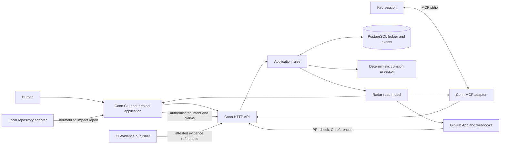

# Design

## Purpose and approved scope

This specification evolves Conn from a ratified team-blueprint system into an explainable semantic coordination layer and project radar. It preserves Conn's existing authority model:

- Humans own Project membership, Objective revisions, BlueprintRevision proposals, and Charter acceptance.
- Agents may publish, revise, and release their own change Intents directly after authenticating through the human's bounded Conn session.
- Agents may propose claims and resolutions, but cannot approve binding decisions, alter approved boundaries, or accept high-risk risk decisions.
- Conn coordinates through shared records and events. It never launches agents, assigns work, or becomes a central planner.

The implementation is **not limited to one repository or a three-session trial**. The protocol supports multiple RepositoryConnections, concurrent participants, and manual declared claims from the outset. The first observed-claim adapter is TypeScript analysis, the first coding-agent adapter is Kiro, and the first repository-host adapter is GitHub. Unsupported repositories still receive value from declared intents, assumptions, objective context, and the decentralized resolution protocol.

Repository analysis runs locally by default. Conn transmits normalized coordination facts, not raw repository content, prompts, or agent transcripts.

## Product outcome

Conn must answer these questions for an authorized human:

- What outcome and accepted boundaries currently govern this project?
- What active work is intended, by whom or by which bounded agent participant?
- Which assumptions, questions, contracts, data resources, invariants, or symbols connect that work?
- Which relationships are observed facts, declarations, or uncertain inferences?
- What could collide, why, and what evidence supports that conclusion?
- What decision has the team made, and what remains unresolved or unverified?

The resulting Radar is a project-understanding read model. It is not an agent activity feed and does not infer productivity, progress, quality, or accountability from message volume, changed files, or model usage.

## Architectural shape



`conn` remains one Go executable. The existing CLI, terminal application, MCP adapter, HTTP server, PostgreSQL access, JSON Schema contracts, and project event model remain the primary boundaries.

The TypeScript analyzer is a local Node.js workspace. It reads an authorized local worktree and emits a schema-validated impact report. It does not connect directly to PostgreSQL and does not receive Conn session credentials. The Go CLI or a later local adapter validates the report and sends only accepted normalized claims through Conn's authenticated HTTP API.

A persistent sidecar, browser application, graph database, hosted source index, vector database, generic workflow engine, and remote MCP transport remain deferred.

## Authority and participant identity

### Human identity

Existing Conn sessions identify a Human. Human identity remains the authority for membership and all binding project decisions.

### Participant identity

An Intent is attributed to a `Participant`, which is a bounded operating identity under one authenticated Human:

```text
Participant
  participant_id          UUIDv7
  project_id              UUIDv7
  human_id                UUIDv7
  adapter_kind            kiro | cli | ci | github | other_registered_adapter
  local_session_ref       optional opaque, non-secret reference
  display_label           optional, human-readable
  created_at
  retired_at              optional
```

The server derives `human_id` from the Conn session. An MCP or HTTP request cannot select a different human through its input document. `local_session_ref` is an opaque client-generated correlation identifier, never a raw Kiro session transcript, prompt, path, token, or machine identifier.

A participant may create, revise, and release only its own Intents. The server creates a participant on first authenticated use or reuses a matching bounded participant. This supports direct agent publication without granting an agent independent human authority.

### Binding decisions

The following records remain human-authoritative:

- Project membership and RepositoryConnection management;
- Objective and BlueprintRevision creation or revision;
- Charter acceptance or rejection;
- a Resolution that changes an approved boundary;
- acceptance of a high-risk collision;
- adoption of a binding contract agreement;
- project policy changes.

An agent may submit a `ResolutionProposal`. It remains non-binding until an authorized human records a separate `ResolutionDecision`.

## Core domain model

### RepositoryConnection

A Project may have more than one repository connection.

```text
RepositoryConnection
  repository_id           UUIDv7
  project_id              UUIDv7
  host_kind               github | generic_git
  canonical_remote        normalized origin URL, not a credential-bearing URL
  host_repository_node_id optional immutable host ID
  default_branch          optional
  analysis_enabled        boolean
  created_by_human_id
  created_at
```

The initial CLI can bind a repository from local Git metadata. A GitHub App later verifies a GitHub installation and immutable repository node ID. A RepositoryConnection does not confer repository write permission to Conn.

### Intent and immutable IntentRevision

An Intent is the active coordination identity. An `IntentRevision` is an immutable snapshot. Intent status is a projection beside revisions.

```text
Intent
  intent_id               UUIDv7
  project_id              UUIDv7
  participant_id          UUIDv7
  status                  active | released | superseded
  current_revision        positive integer
  created_at

IntentRevision
  intent_id
  revision
  objective_id
  objective_revision
  blueprint_id            optional
  blueprint_revision      optional
  charter_id              optional
  repository_id           optional
  base_revision_ref       optional Git commit SHA
  head_revision_ref       optional Git commit SHA
  branch_ref              optional non-secret branch name
  summary_markdown
  assumptions[]
  declared_claims[]
  created_at
```

An Intent must reference one exact current or historical Objective revision. It may reference an active Charter when the participant has one. Missing Charter association is visible in the Radar as an unpartitioned intent, not silently treated as authorized charter scope.

A revision replaces the active projection only after optimistic-concurrency validation. Releasing closes the current projection but preserves all versions and assessments. An active Intent cannot be silently retargeted to a new Objective revision; a new IntentRevision must state the new relationship.

### SemanticClaim

A claim states that a coordination concept is relevant to an Intent, Objective, evidence item, or repository revision.

```text
SemanticClaim
  claim_id                UUIDv7
  project_id
  subject_kind            behavior | invariant | contract | data_resource |
                          infrastructure_resource | code_symbol | dependency |
                          assumption | question | acceptance_criterion
  normalized_subject      stable namespaced key
  display_name            concise, human-readable label
  relation                affects | changes | consumes | produces | depends_on |
                          removes | verifies | assumes | questions
  provenance_kind         declared | static_analysis | external_import |
                          ci_evidence | model_inference
  confidence              required for model_inference; optional otherwise
  evidence_refs[]         typed references, never raw source content
  producer_participant_id optional
  observed_at
```

Examples of initial normalized subjects:

```text
invariant:checkout:one-idempotency-key-one-successful-charge
symbol:typescript:src/payment/service.ts#PaymentService.charge
openapi:POST:/payments
data:postgres:payment_attempts.idempotency_key
migration:postgres:payment_attempts:add-idempotency-key
```

The protocol preserves native tool identifiers and source references alongside the normalized subject. It does not claim two native identifiers are identical unless a deterministic extractor, declared mapping, or reviewed human decision says so.

### CollisionAssessment

A collision is an explainable relationship between two active Intent revisions. It does not itself command a resolution or block work.

```text
CollisionAssessment
  collision_id            UUIDv7
  project_id
  left_intent_id
  left_intent_revision
  right_intent_id
  right_intent_revision
  rule_id
  severity                info | amber | red
  confidence
  state                   open | under_review | resolved | dismissed | stale
  matching_claim_refs[]
  supporting_context_refs[]
  explanation_markdown
  created_at
  superseded_at           optional
```

The first deterministic rules are:

| Rule ID                      | Match condition                                                                              | Initial severity                                                    |
| ---------------------------- | -------------------------------------------------------------------------------------------- | ------------------------------------------------------------------- |
| `shared_declared_invariant`  | Two active intents affect or change the same declared invariant                              | amber                                                               |
| `shared_exported_symbol`     | Two active intents affect or change the same resolved exported TypeScript symbol             | amber                                                               |
| `contract_producer_consumer` | One intent changes or removes a contract another consumes or depends on                      | amber; red when a compatibility extractor proves breakage           |
| `schema_resource_overlap`    | Two active intents change the same table, column, index, constraint, or migration assumption | amber; red when incompatible operations are deterministically known |

File-path overlap may be listed as supporting context. It is never sufficient to create a CollisionAssessment.

Severity means coordination urgency, never developer performance or merge eligibility. `red` asks for an explicit human decision before a team policy may later enforce a gate. In this specification, all assessments remain advisory.

### ResolutionProposal and ResolutionDecision

```text
ResolutionProposal
  proposal_id             UUIDv7
  collision_id
  proposed_by_participant_id or human_id
  kind                    dependency | sequencing | contract_agreement |
                          accepted_risk | false_positive | revise_objective |
                          revise_blueprint | other
  rationale_markdown
  references[]
  created_at

ResolutionDecision
  decision_id             UUIDv7
  collision_id
  selected_proposal_id    optional
  decided_by_human_id
  kind                    same vocabulary as proposal
  binding                 boolean
  rationale_markdown
  references[]
  created_at
```

A `dependency` creates an explicit intent-to-intent dependency edge. A `contract_agreement` may create a reviewed contract claim. `accepted_risk`, `contract_agreement`, and any decision to revise an Objective or Blueprint are binding and require an authorized human. A false-positive decision preserves the evidence and rule result for future policy tuning.

### EvidenceReference

Evidence remains reference-first:

```text
EvidenceReference
  evidence_id             UUIDv7
  project_id
  intent_id               optional
  objective_id
  objective_revision
  acceptance_key          optional
  kind                    commit | pull_request | ci_run | test_case |
                          trace | artifact | decision | external_link
  state                   passing | failing | missing | stale | inaccessible | unknown
  locator                 access-controlled URL, commit SHA, or opaque external ID
  content_hash            optional
  producer                participant or verified integration
  observed_at
```

Conn stores a safe summary and link, not large artifacts, source, raw test output, or sensitive trace payloads. Evidence coverage is calculated from explicit Objective acceptance-key references. It never treats a commit, changed file, or agent assertion as proof by itself.

## Local analysis and data minimization

### TypeScript analyzer

The first analyzer implementation lives in `packages/typescript-analyzer`. It uses the repository `tsconfig` and TypeScript compiler API to identify:

- changed and predicted source files supplied by the Intent or Git diff;
- exported declarations and stable symbol identifiers;
- imports and resolved producer-consumer relationships;
- compiler diagnostics that limit confidence.

The analyzer produces a bounded report such as:

```json
{
  "report_version": 1,
  "repository": {
    "canonical_remote": "github.com/acme/payments",
    "head_revision_ref": "a1b2c3d4",
    "branch_ref": "feat/retry"
  },
  "claims": [
    {
      "subject_kind": "code_symbol",
      "normalized_subject": "symbol:typescript:src/payment/service.ts#PaymentService.charge",
      "relation": "affects",
      "provenance_kind": "static_analysis",
      "evidence_refs": [
        {
          "kind": "source_location",
          "path": "src/payment/service.ts",
          "line": 44,
          "symbol": "PaymentService.charge"
        }
      ]
    }
  ],
  "diagnostics": []
}
```

The CLI validates the report schema before submitting it. The report must not contain source text, source excerpts, prompt content, secrets, or an unbounded diagnostic payload. Conn may retain path and symbol names because they are required to explain the claim. Projects needing stronger metadata minimization can disable observed analysis and use declared claims only.

### Future extractors

The semantic-claim contract anticipates OpenAPI and SQL schema extractors without requiring their implementation in the first vertical slice. When added, they must follow the same local-report boundary and create typed evidence references rather than raw document uploads.

Model inference is deferred. If later enabled, it must produce `model_inference` provenance, confidence, input references, and a human-reviewable explanation. It cannot independently create a blocking or binding decision.

## Radar read model and surfaces

The Radar composes authoritative records into one project snapshot:

```text
RadarView
  project and as_of_event
  governing_objectives
  active_blueprint
  repository_connections
  active_intents
  semantic_concepts
  open_collisions
  decisions and dependencies
  open_questions and assumptions
  acceptance_evidence_coverage
  known_unknowns and stale observations
```

The first human surface is `conn app`, which gains a **Radar** section beside its existing project views. It shows concise counts, status labels, and drill-down views for objective coverage, active intents, collisions, and unresolved items. Color is supplementary and never the sole signal.

The CLI provides compact status and detailed explain commands. The MCP adapter returns the same read model or focused slices so that Kiro can answer a human's question using shared records. A later web application consumes the same API and does not define a competing model.

## Conflict context pack

The `ConflictContextPack` is the portable artifact that allows a human to take Conn's facts to any coding agent or collaboration channel. It is available as machine-readable JSON and bounded Markdown.

```text
ConflictContextPack
  collision identity and current state
  governing Objective and relevant Charter excerpts or references
  both Intent revisions and assumptions
  matching claims and evidence references
  uncertainty and confidence labels
  decisions already made and dependencies already accepted
  unresolved question for participants
  allowed resolution proposal kinds
  safe handling note
```

The Markdown rendering is designed for copy/paste into an agent session. It describes claims as supplied project context, not privileged instructions. It must tell the recipient to treat incomplete or untrusted claims as data and to return a resolution proposal, risks, and missing evidence. It must not include raw prompts, secrets, or unbounded source content.

Conn does not send the pack to another agent automatically. A human chooses the agent and conversation in which to use it.

## Kiro MCP protocol changes

The existing read tools remain. Add the following tools in a new versioned capability set:

| Tool                    | Authority and behavior                                                                                                           |
| ----------------------- | -------------------------------------------------------------------------------------------------------------------------------- |
| `publish_intent`        | Creates the caller participant's Intent revision from declared claims and assumptions. The human comes from the Conn session.    |
| `revise_intent`         | Appends a revision of the caller participant's own active Intent with optimistic concurrency.                                    |
| `release_intent`        | Releases the caller participant's own Intent.                                                                                    |
| `analyze_intent_impact` | Requests bounded local analyzer output through the local adapter path, then attaches observed claims. It does not upload source. |
| `check_collisions`      | Returns open assessments and supporting references for an Intent or project scope.                                               |
| `read_radar`            | Returns the current Radar view or a focused slice.                                                                               |
| `read_conflict_context` | Returns a ConflictContextPack.                                                                                                   |
| `propose_resolution`    | Stores a non-binding ResolutionProposal.                                                                                         |
| `attach_evidence`       | Attaches bounded evidence references only where the participant is authorized.                                                   |

No MCP tool may accept a `human_id` as an authority input. No MCP tool accepts a charter, approves a ResolutionDecision, mutates an Objective or BlueprintRevision, changes membership, or configures a policy.

The first protocol continues to use local stdio MCP. Remote Streamable HTTP is deferred until Conn needs remote multi-client access and a reviewed authorization model.

## CLI and HTTP API additions

Illustrative CLI surface:

```text
conn repository connect --project <uuid> [--from-git]
conn repository list --project <uuid>

conn intent publish --project <uuid> --file <intent.json>
conn intent revise --project <uuid> --intent <uuid> --expected-revision <n> --file <intent.json>
conn intent release --project <uuid> --intent <uuid>
conn intent analyze --project <uuid> --intent <uuid>
conn intent list --project <uuid>

conn radar --project <uuid>
conn conflicts --project <uuid>
conn explain <collision-id>
conn conflict context <collision-id> [--format json|markdown]
conn resolution decide --project <uuid> --collision <uuid> --file <decision.json>
conn evidence attach --project <uuid> --file <evidence.json>
```

New HTTP routes follow existing `/v1` envelope, authentication, body-size, and error conventions:

```text
POST   /v1/projects/{project_id}/repositories
GET    /v1/projects/{project_id}/repositories

POST   /v1/projects/{project_id}/intents
POST   /v1/projects/{project_id}/intents/{intent_id}/revisions?expected_revision=<n>
POST   /v1/projects/{project_id}/intents/{intent_id}/release
GET    /v1/projects/{project_id}/intents
POST   /v1/projects/{project_id}/intents/{intent_id}/claims

GET    /v1/projects/{project_id}/radar
GET    /v1/projects/{project_id}/collisions
GET    /v1/projects/{project_id}/collisions/{collision_id}
GET    /v1/projects/{project_id}/collisions/{collision_id}/context
POST   /v1/projects/{project_id}/collisions/{collision_id}/proposals
POST   /v1/projects/{project_id}/collisions/{collision_id}/decisions

POST   /v1/projects/{project_id}/evidence
```

The exact schemas and route names require contract review before implementation. Write responses append project events atomically and return the post-commit `as_of_event` cursor. Stale Intent or Resolution writes return the existing conflict exit category and a safe error code.

## Collision lifecycle

1. A participant publishes or revises an Intent.
2. Conn stores declared claims and appends an event.
3. Local analysis may later attach observed claims to that Intent revision.
4. The deterministic assessor compares current active revisions in relevant Project and RepositoryConnection scope.
5. Conn upserts a CollisionAssessment keyed by the involved intent revisions and rule, then appends an event for a materially changed assessment.
6. The Radar, CLI, and MCP surface the assessment as advisory information.
7. A participant asks Conn for a context pack and may use it with an agent of their choice.
8. An agent or human proposes a resolution.
9. An authorized human records a binding decision where required.
10. New Intent revisions, releases, objective revisions, or evidence can make the assessment stale, resolved, dismissed, or newly open. Historical assessments remain queryable.

The assessor operates from explicit claims and graph edges. It must be deterministic, idempotent, bounded by project scope, and independently testable. It does not call an LLM.

## Objective import design

Kiro specifications and GitHub issues are import sources, not live masters after import.

An importer:

1. reads the source through an authorized local or GitHub adapter;
2. creates a bounded source reference containing system, stable ID or path, source revision where available, and content hash;
3. proposes a Conn Objective revision; and
4. leaves the actual Objective creation or revision to existing human authority.

A later source refresh compares hashes and presents a diff summary. It never modifies Conn records automatically. The Radar displays both the imported source reference and whether a later Conn revision diverged.

## GitHub and CI integration sequence

GitHub Device Flow remains for human sign-in. Repository integration uses a separate GitHub App identity, installation, webhook secret verification, delivery deduplication, and least-privilege repository access.

The GitHub App is introduced after local intent and collision behavior works. Its initial functions are:

- verify a RepositoryConnection against immutable GitHub repository identity;
- receive pull-request and check/CI-related webhooks;
- associate PR and commit references with existing Intents;
- publish an advisory Conn check linking missing intent, open collisions, and evidence coverage to the PR.

It never writes repository source, creates branches, merges pull requests, or approves reviews. CI evidence uses authenticated, idempotent submissions. Support for speculative combined-branch verification and merge-queue events is deferred until the team has targeted interaction tests to run.

## PostgreSQL and event design

Add tables and projections consistent with the existing append-only and optimistic-concurrency model:

- `repository_connections`;
- `participants`;
- `intents` and immutable `intent_revisions`;
- `semantic_claims` and `claim_evidence_refs`;
- `intent_claims` if claims are de-duplicated separately from immutable snapshots;
- `collision_assessments` and `collision_claim_matches`;
- `resolution_proposals` and append-only `resolution_decisions`;
- `evidence_references` and acceptance-criterion associations;
- verified external delivery receipts for future GitHub and CI integrations.

Snapshots may use `jsonb` with query-critical identifiers, current status, revision, provenance, timestamps, and foreign keys projected into typed columns. Database constraints must prevent a participant from owning intents under another Human and prevent a collision from relating records in different Projects.

New project event types include at least:

```text
repository_connected
intent_published
intent_revised
intent_released
claims_observed
collision_opened
collision_updated
resolution_proposed
resolution_decided
evidence_attached
objective_imported
```

## Validation plan

Fundamental scenarios replace per-handler test proliferation:

1. **Agent publication authority:** an authenticated Kiro participant publishes, revises, and releases its own Intent; it cannot impersonate another Human or modify an Objective, Blueprint, Charter, or binding decision.
2. **Privacy boundary:** a valid local analyzer report creates observed claims; source text, prompt fields, credential-shaped values, and oversized diagnostics are rejected or redacted.
3. **Deterministic collision:** two active intents create each initial rule category; a same-file-only pair does not create a semantic collision; an assessment explains its exact matching claims.
4. **Resolution protocol:** an agent proposal is non-binding; a human records a binding decision; concurrent revisions return a conflict; events and state commit together.
5. **Radar completeness:** the same project snapshot shows governing objective, active intents, collisions, decisions, assumptions, and evidence state, including explicit unknowns.
6. **Source imports:** importing a Kiro specification or GitHub issue records provenance; changing the external source does not mutate the Conn Objective.
7. **GitHub boundary:** when implemented, signed webhook deliveries are processed once, untrusted deliveries are rejected, and the integration cannot write code or merge a pull request.

Run the existing `pnpm check`, `pnpm test`, and `pnpm build` validation. Add no coverage-percentage gate.

## Deferred work

- Browser-based Radar and conflict room
- Remote MCP transport and remote MCP authorization
- GitLab, Jira, Linear, Slack, Teams, and other coding-agent adapters
- OpenAPI and SQL extractor implementations
- Model inference, embeddings, vector search, and hosted source indexing
- Graph database adoption
- Persistent sidecar, local SQLite outbox, SSE, WebSockets, and background polling
- Generic policy engines and merge blocking
- Speculative combined-branch execution, merge queues, and autonomous remediation
- Dedicated desktop application, central agent orchestration, automatic task assignment, autonomous merge, and employee analytics
